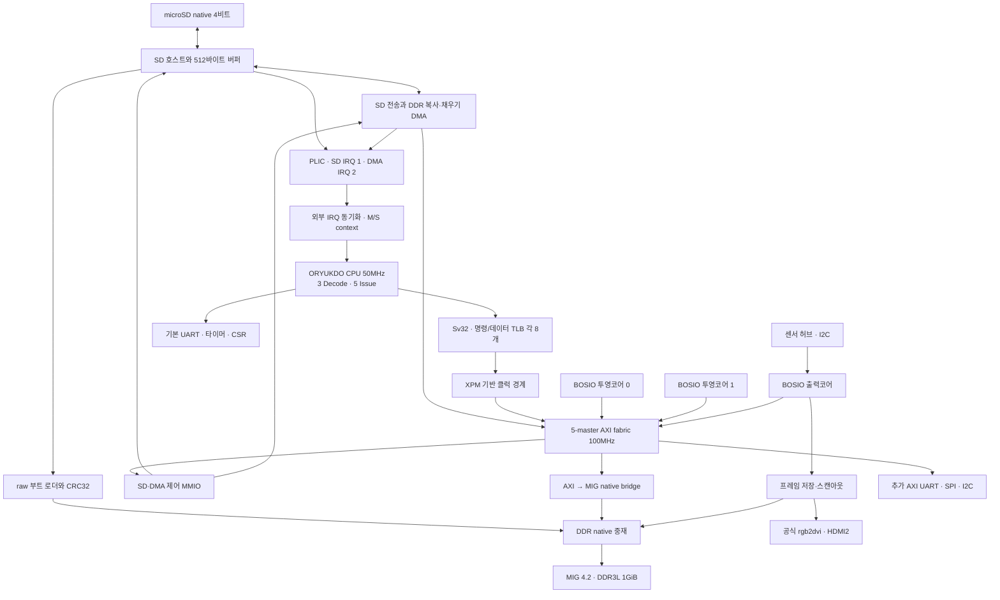

# SoC 구조와 주소 맵

이 문서의 현재 구성은 **`variants/sd4-dma/`의 2026-11-10 SD4·DMA 후보**이다.
저장소 루트의 `soc/`, `rtl/`, `gen2/`는 2026-11-08 실보드 부팅 검증본으로 보존했다.
두 구성은 각각 자기 디렉터리의 `soc/bosio_sources.f`를 사용한다. RTL 목록을 섞지 않는다.

## 현재 연결

부팅 전에는 raw 로더가 SD/DDR 경로를 소유한다. 검증 후 CPU를 해제하고 Linux 런타임 호스트로
소유권을 넘긴다. raw 로더의 바이트 입력·CRC32·DDR 기록 경로는 유지했으며 새 DMA로 대체하지 않았다.
Linux SD 읽기는 수신 CRC 확인 뒤 버퍼에서 DDR로 DMA 전송한다. 쓰기는 DDR에서 버퍼를 채운 뒤 카드에 전송한다.
초기화는 400kHz, 전송은 최대 4비트 25MHz이며 한 명령에서 한 블록(최대 512바이트)을 처리한다.

CPU가 제어하는 같은 저장소 DMA 블록은 DDR의 비중첩 복사와 32비트 패턴 채우기도 지원한다.
4바이트 정렬, 최대 16워드/64바이트 burst, 4KiB 경계 분할을 사용한다.
AXI master는 CPU·투영 0·투영 1·출력·저장소 DMA의 5개다. DMA 쓰기는 CPU 원자적 잠금과 예약 무효화 경로를 통과한다.
중재는 접근 순서를 보장하며, 활성 화면·작업 버퍼의 논리적 소유권은 소프트웨어가 관리한다.

## CPU와 스케줄러

NEL/IST/FCL/FDU/PRM/RS/WBC 구조, 비순차 실행, 다중 완료와 Commit을 유지한다.
별도의 대형 ROB나 Architectural Register File로 교체하지 않았다. 물리 레지스터 데이터 저장소는 스케줄러 외부에 있다.
실행기는 Branch·CSR 1개, ALU 2개, MULDIV 1개, LSQ 1개다.

기본 구성은 IST 128, PHYREG 64, Flow Window 8개×16명령, Window당 분기 체크포인트 4개다.
Static Not Taken, Rename Mapping 복원, 순서 기반 예외, Window 경계 인터럽트와 Store·CSR·부작용 접근의 Commit 제어를 유지한다.
이번 저장소 추가에서는 스케줄러 알고리즘을 바꾸지 않았다. CSR의 MEIP/SEIP·위임·우선순위와 PLIC M/S context를 연결했다.

CPU는 RV32IMA, Zicsr, Zifencei, M/S/U와 Sv32를 사용하고 DT는 Svade를 명시한다.
명령/데이터 TLB는 각각 8엔트리이며 SATP·VPN·권한·접근 종류·SUM/MXR을 구분한다.
SFENCE.VMA/SATP 변경 시 무효화하고 진행 중인 페이지 테이블 응답을 배출한 뒤 다시 변환한다.

## 메모리와 MMIO

| 주소 | 현재 SD4 구성의 용도 |
|---|---|
| 0x80000000..0xbfffffff | DDR 물리 메모리 1GiB |
| 0x80000000 / 0x80400000 / 0x87f00000 | OpenSBI / Linux Image / DTB 적재 시작 |
| 0xbd000000..0xbdffffff | BOSIO 드라이버 전용 16MiB shared-dma-pool, `no-map` |
| 0xbf800000..0xbfffffff | 표시 버퍼 예약 8MiB, `no-map` |
| 0x10000000 | 기본 UART, OpenSBI/Linux 콘솔 |
| 0x02004000 / 0x0200bff8 | 타이머 비교값 / 시간값 |
| 0x0c000000..0x0c3fffff | PLIC: source 1=SD, source 2=복사·채우기 DMA |
| 0x10004000 | SoC 상태 |
| 0x10005000 / 0x10006000 / 0x10007000 | 추가 AXI UART / SPI / I2C |
| 0x10008000..0x10008033 | native SD 호스트 |
| 0x10009000..0x10009017 | CPU 제어 DMA |
| 0x20000000 / 0x20010000 / 0x20020000 | 투영 0 / 투영 1 / 출력 제어 |

주소의 근거는 [AXI 주소 디코더](../variants/sd4-dma/soc/bosio/or_bo_axi_pkg.sv)와
[SD4 장치 트리](../variants/sd4-dma/software/bosio/gen3-bosio.dts)다.
AXI-Lite 목적지는 10개이며 RAM 목적지는 `RAM_PORT=LITE_PORTS`이다.
보드 bridge에 남아 있던 고정값 7을 이 상수로 수정했다. PLIC context 0/1은 hart0 M/S에 대응한다.
기본 UART는 polling 콘솔이며 추가 AXI UART·SPI·I2C와 BOSIO 완료 신호는 이번 PLIC source에 연결하지 않았다.

DDR은 512MiB 칩 두 개로 만든 하나의 32비트 MIG 채널이다. Linux 가용 RAM에는 예약 영역·커널 등이 제외된다.
SD 파티션 1은 raw 부팅 데이터, 파티션 2는 256MiB ext4 `/data`다. 루트는 기존 initramfs이며 카드 전체 용량 자동 확장은 없다.
기본본과 달리 SD4 후보에는 Linux 파일 저장 경로가 구현됐지만 실보드 탐색·마운트·영구 보존 검증은 아직 남아 있다.

## BOSIO·HDMI와 변경 범위

HDMI는 고정 1280×720 60Hz RGB/DVI 호환 TMDS이며 오디오·EDID·HDCP는 제공하지 않는다.
BOSIO Linux ABI 3 소스와 이미지의 BoAYO native-v2는 보존했다. 새 저장소 DMA를 BoAYO 렌더링에 연결하지는 않았다.
완성된 프레임을 게시할 구동 SW가 필요하며 UART 셸 도달만으로 HDMI 화면 성공을 판정하지 않는다.
기존 보드에서의 관측과 이번 SD4 이미지의 실보드 검증은 구분한다.

루트 기준본의 SD는 SPI 부팅 전용이었다. 현재 후보는 native SD·DMA·PLIC·파일시스템을 추가한 별도 구성이다.
MIG·공식 HDMI IP 본문은 유지했다. [상세 변경 내역](../variants/sd4-dma/README_STORAGE_KO.md)과
[검증 경계](검증.md)를 함께 확인한다.
