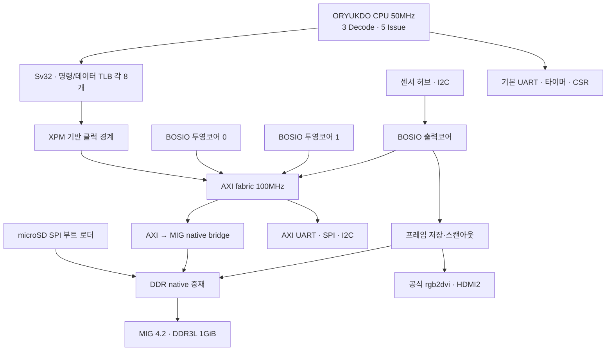

# SoC 구조

## CPU와 스케줄러

스케줄러는 NEL/IST/FCL/FDU/PRM/RS/WBC 구조를 재사용하며 비순차 실행, 다중 완료와 Commit을 유지한다. 별도의 대형 ROB나 Architectural Register File로 교체한 구조가 아니다. CPU의 물리 레지스터 데이터 저장소는 스케줄러 외부에 있다.

기본 구성은 IST 128, PHYREG 64, Flow Window 8개×16명령, Window당 분기 체크포인트 4개이다. Static Not Taken 예측, Rename Mapping 복원, 명령 순서 기반 예외 처리, Window 경계 인터럽트, Store·CSR·부작용 있는 접근의 Commit 제어를 사용한다. 실제 컴파일 목록은 `soc/bosio_sources.f`이다. 같은 이름의 이전 GitHub Gen3 구현과 혼합하면 안 된다.

CPU는 RV32IMA, Zicsr, Zifencei, M/S/U 권한과 Sv32 변환을 사용한다. DT는 Svade를 명시한다. TLB는 SATP·VPN·권한·접근 종류·SUM/MXR을 구분하고, SFENCE.VMA 및 SATP 변경 시 무효화한다. 진행 중인 페이지 테이블 응답은 배출 후 변환을 다시 시작한다.

## 메모리와 주소

| 주소 | 용도 |
|---|---|
| 0x80000000..0xbfffffff | DDR 물리 메모리 1GiB |
| 0x80000000 | OpenSBI 적재 시작 |
| 0x80400000 | Linux Image 적재 시작 |
| 0x87f00000 | DTB 적재 시작 |
| 0xbf800000..0xbfffffff | 영상용 예약 8MiB, DT `no-map` |
| 0x10000000 | 기본 UART, OpenSBI/Linux 콘솔 |
| 0x02004000 / 0x0200bff8 | 타이머 비교값 / 시간값 |
| 0x10004000 | SoC 상태 레지스터 |
| 0x10005000 / 0x10006000 / 0x10007000 | 추가 AXI UART / SPI / I2C |
| 0x20000000 / 0x20010000 | BOSIO 투영 0 / 1 제어 |
| 0x20020000 | BOSIO 출력 제어 |

DDR은 512MiB 칩 두 개로 구성한 하나의 32비트 MIG 채널이다. DDR 중재는 동시 접근을 순서대로 전달하는 장치다. 버퍼 주소의 논리적 소유권은 소프트웨어가 관리해야 한다. 영상 저장소는 CPU와 일관성을 자동 유지하는 공유 프레임버퍼가 아니며, 활성 표시 버퍼에 다른 DMA/CPU 접근이 겹치면 안 된다.

HDMI는 고정 1280×720 60Hz RGB/DVI 호환 TMDS이다. 오디오·EDID·HDCP는 제공하지 않는다. 초기에는 완성된 프레임이 없으면 검은 화면이며 Linux 쉘 부팅만으로 데스크톱이 나오지 않는다. BoAYO 적용에는 BOSIO 구동 SW와 버퍼 소유권·동기화 설계가 추가로 필요하다.
